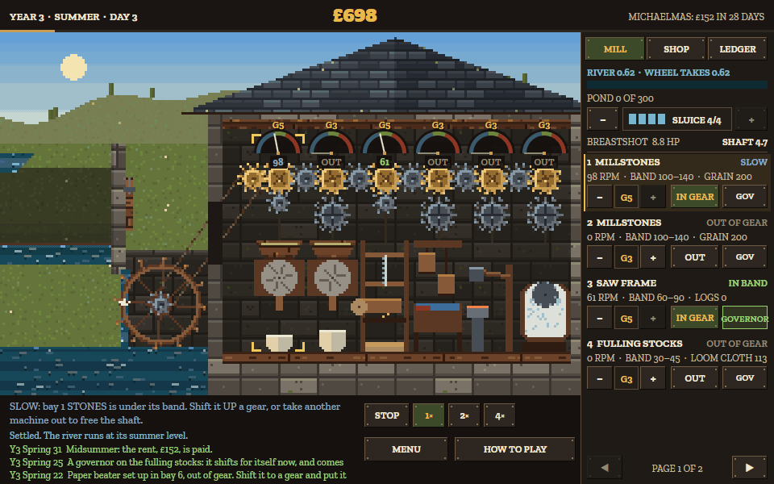

# OVERSHOT

A free browser incremental about a water mill on a river that shifts with the seasons. Made during **GitHub Game Off 2026** (theme: **SHIFT**) by Core Systems Asset Factory.

**Play it in your browser:** https://csaf.itch.io/overshot



## The idea

One water wheel turns one line shaft. Every machine on it (millstones, a saw frame, fulling stocks, a trip hammer, a paper beater) has its own gearbox and a speed band. Every machine you put in gear slows the whole shaft, and the river under the wheel shifts with the seasons: a spring flood races everything, a summer drought drags it all. You shift each machine's gears to hold it in its band, store the flood in a mill pond for the drought, pay the manor its rent every quarter day, and buy the freehold.

Three shifts, each a mechanic: **shift gears** (every machine), **shift power** (one shaft, who runs decides who slows), **shift water through time** (the pond).

## Running it

No build step and no dependencies. Serve the folder with any static server and open `index.html`, for example:

```
npx serve .
```

or open `index.html` directly in a browser (the music file needs a server in some browsers; the game falls back to rendering the same tune in code).

## How the code is laid out

| file | what it does |
| --- | --- |
| `js/sim.js` | the rules: river, pond and sluice, wheel power, the shared shaft, gearboxes, speed bands, wear, seasons, rent, the checkpoint. No DOM; runs the same under Node. |
| `js/render.js` | the mill painted at 240x150 native pixels from the texture plates and the game's own gear and machine drawers, scaled up nearest-neighbour; the dials; the text and button door. |
| `js/game.js` | screens (title, mill, shop, ledger, menu, help, credits, endings), three layouts (desktop, phone upright, phone sideways), input, save and resume. |
| `js/audio.js` | every sound and the music, synthesised in code; a live shaft hum whose pitch follows the shaft speed. |
| `art/` | five texture plates (stone, boards, water, meadow, slate) made by the studio's pixel generator. |
| `audio/overshot_theme.ogg` | the music loop, rendered from `js/audio.js` once. |
| `fonts/` | Alfa Slab One and Zilla Slab, SIL Open Font License (texts included). |

The model in one paragraph: inflow fills the pond; the sluice lets up to sluice x intake through the wheel; wheel flow f gives power P = 10 f x head x gearing and a free shaft speed S0 = 12 f; each machine in gear loads the shaft by k r / mid; the shaft settles at S = S0 / (1 + S0 K / 3P); a machine turns at r S.

## Made with AI

This game was made with AI, as Game Off 2026's rules allow and ask us to disclose: the code, the drawing code, the text and the music were written with Claude, an AI model, working for the studio; the cover painting was made with an AI image model. All sound is synthesised by the game's own code; no recorded samples.

## Licence

Code: MIT. Art, music and text: all rights reserved (play, stream and record freely). Fonts: SIL OFL 1.1. See `LICENSE.txt`.

More free browser games from the same studio: https://csaf.itch.io
